# Ned 대시보드 디자인 제안 (5안)

다섯 안 모두 정적 HTML 이고 빌드 단계가 없다. 같은 [`fixture.js`](fixture.js) 를 읽으므로 내용이 똑같아 나란히 비교할 수 있다.
fixture 는 실제 daemon API 응답(`/api/state`, `/api/briefings`, `/api/events`, `/api/config`)을 그대로 찍어 둔 것이다.
찍은 환경은 `NED_HOME=/tmp/ned-dash NED_NO_LLM=1` 이다. 타임스탬프는 열 때마다 "지금" 기준으로 다시 맞춘다.

- 파일을 브라우저로 바로 열면 fixture 로 그린다. `?empty=1` 을 붙이면 "새것 없음" 상태를 볼 수 있다.
- daemon 이 같은 출처에서 서빙하면 `NED.load()` 가 실제 API 를 먼저 쓴다. API 는 상대 경로(`/api/...`)로 부르므로 포트를 하드코딩하지 않고 페이지가 열린 포트를 따른다. 미리보기는 실제 daemon(7777) 과 겹치지 않게 `port: 7778` 로 띄운다. 지금 daemon 은 `/` 만 서빙하므로 승격할 때 해당 안을 `index.html` 로 옮기면 된다.
- 리서치 요약은 [`docs/dashboard-research.md`](../../../../docs/dashboard-research.md) 에 있다.

| 안 | 파일 | 한 줄 |
|---|---|---|
| A. 비서의 메모 | [`memo.html`](memo.html) | 책상 위에 두고 간 쪽지처럼 읽는 하루 메모 |
| B. 관제실 | [`command.html`](command.html) | Grafana·터미널 느낌의 3열 고밀도 보드 |
| C. 인박스 / 트리아지 | [`inbox.html`](inbox.html) | Linear·Superhuman 식 목록 + 상세, `j/k` |
| D. 앰비언트 패널 | [`ambient.html`](ambient.html) | 에디터 옆 좁은 창에 띄워 두는 "지금" 카드 |
| E. 사이드킥 | [`sidekick.html`](sidekick.html) | 안경 쓴 "의자에 앉은 친구" 가 채팅으로 브리핑 |

---

## A. 비서의 메모 · `memo.html`
한 열짜리 종이 메모다. 헤드라인 한 줄, 체크리스트로 된 "지금 처리할 것", 세션 상태 문장이 이어지고 나머지는 모두 접힌다.
세리프 제목(Noto Serif KR)에 색은 상태 두 가지만 쓴다. 체크하면 attention 이 닫힌다.
**이럴 때:** 하루 한두 번, 아침 브리핑을 "읽는" 용도가 주일 때. 메일이나 Slack 으로 보내는 브리핑 포맷의 원형으로도 쓸 수 있다.
**약점:** 항목이 열 개를 넘으면 스크롤이 길어진다. 실시간 감시용은 아니다.

| 라이트 | 다크 | 새것 없음 |
|---|---|---|
| 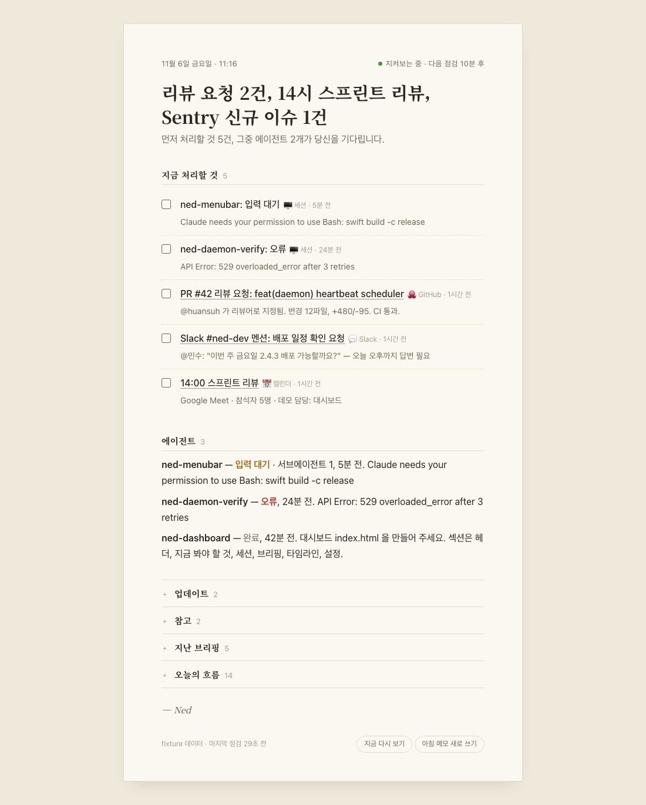 | 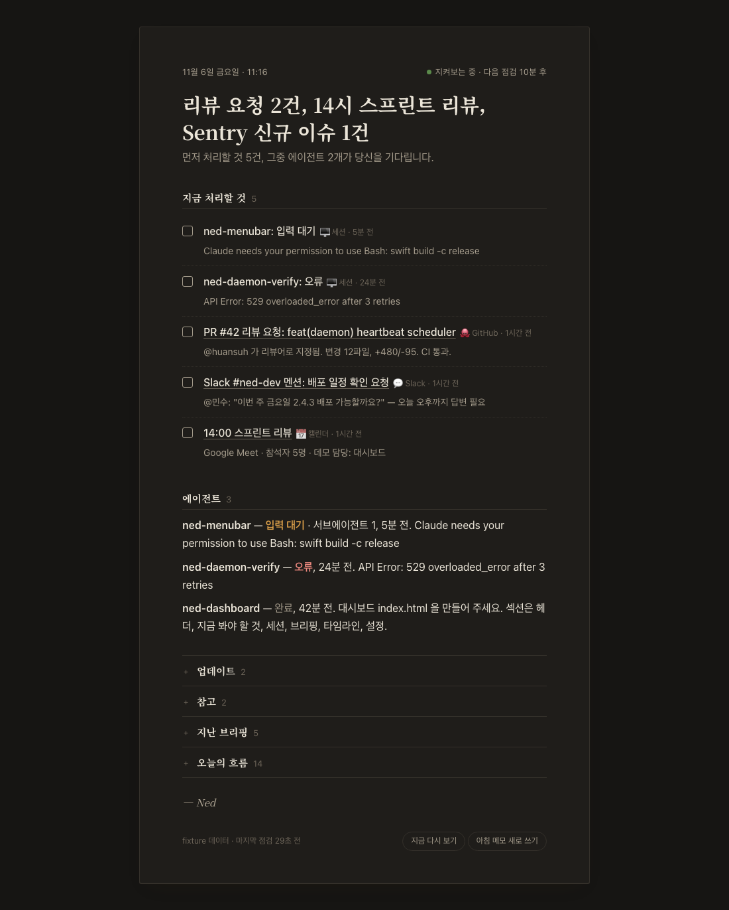 | 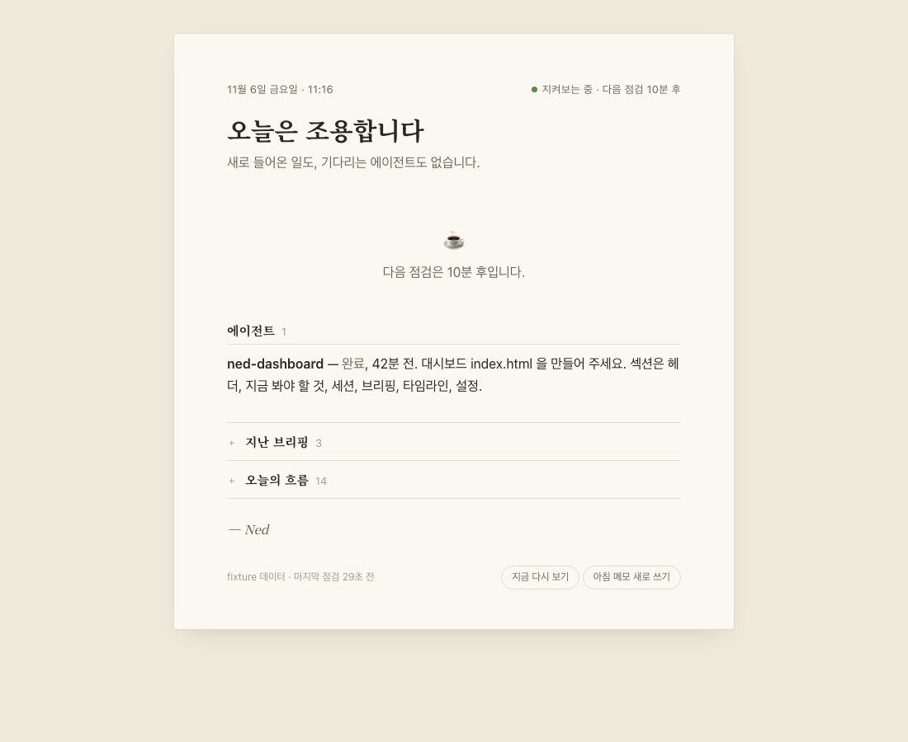 |

## B. 관제실 · `command.html`
왼쪽은 소스·워크트리·이벤트 필터와 개수, 가운데는 attention 표와 로그형 타임라인, 오른쪽은 세션 카드·24시간 heartbeat 막대·브리핑 목록이다.
monospace 를 쓰고 색은 상태색뿐이다. 상단 바에 daemon pid, 다음 점검, 24시간 LLM 비용이 한 줄로 나온다.
**이럴 때:** 에이전트를 여럿 돌리며 큰 모니터 한쪽에 계속 켜 둘 때. 디버깅이나 비용 확인이 잦을 때.
**약점:** 정보가 많아 "비서" 보다는 "도구" 로 느껴진다. 폰 폭에서는 한 열로 접힌다.

| 다크 | 라이트 | 새것 없음 |
|---|---|---|
| 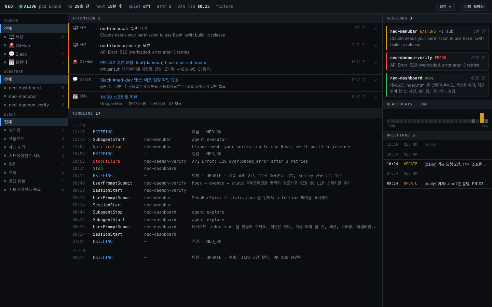 | 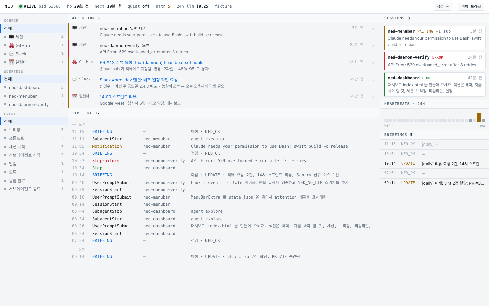 | 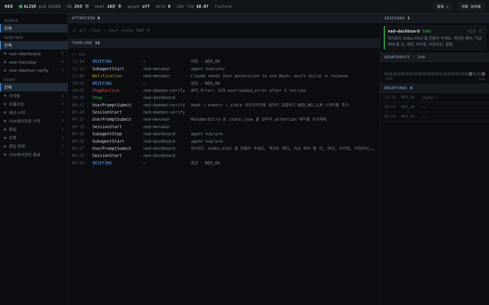 |

## C. 인박스 / 트리아지 · `inbox.html`
왼쪽 목록은 **우선**(attention, 결정 필요)과 **기타**(updates·fyi, 읽기만) 두 탭이다. 오른쪽 상세에는 세션 이벤트나 출처 브리핑 같은 맥락이 붙는다.
`j/k` 이동, `e` 완료, `⏎` 열기, `1/2` 탭, `r` 점검. NED_OK 는 목록 맨 아래 "NED_OK ×N" 한 줄로 접힌다. 다크 우선이고 강조색은 보라 하나다.
**이럴 때:** 처리할 것이 하루 5~20건이고 키보드로 빠르게 비우고 싶을 때. 대시보드를 "할 일 비우는 곳" 으로 쓸 때.
**약점:** 세션 전체 현황은 한눈에 덜 보인다. 상세 패널이 없는 좁은 창에는 맞지 않는다.

| 다크 | 라이트 | 기타 탭 | 새것 없음 |
|---|---|---|---|
| 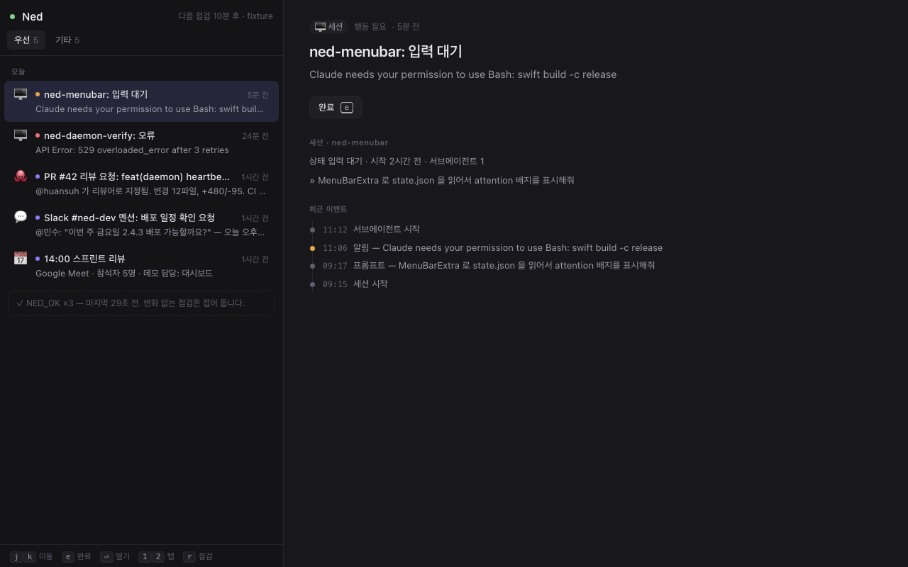 | 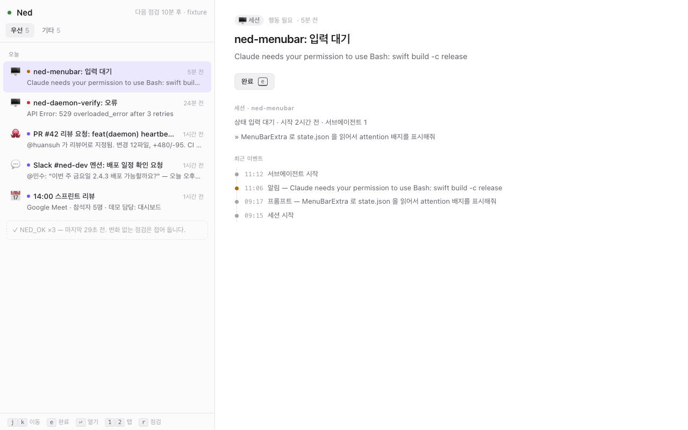 | 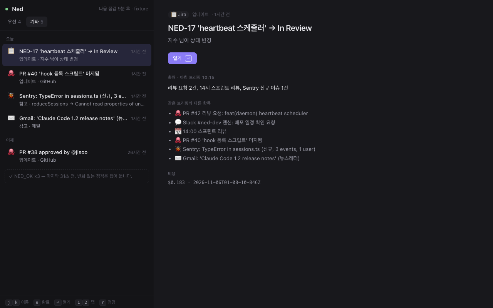 | 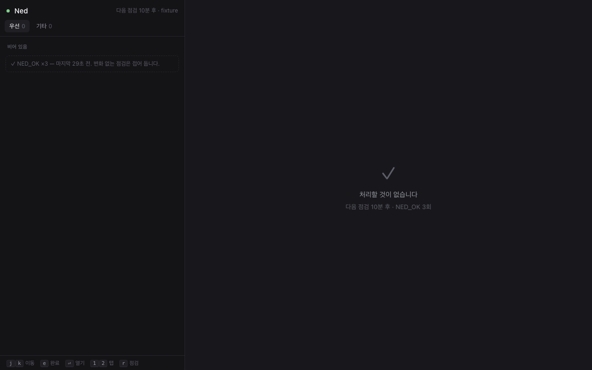 |

## D. 앰비언트 패널 · `ambient.html`
폭 420px 기준이다. 맨 위에 가장 급한 항목 하나를 큰 "지금" 카드로 보이고, 나머지는 그 카드 안 대기열로 둔다.
세션은 상태 점이 붙은 알약, 기록은 가는 세로 실 한 줄이다. 연속된 NED_OK 는 하나로 접는다.
빈 섹션은 아예 그리지 않는다. 헤더의 작은 링은 다음 heartbeat 까지 남은 시간을 보인다.
**이럴 때:** Orca 나 에디터 옆에 좁은 창으로 늘 띄워 둘 때. menu bar 드롭다운의 확장판으로도 쓸 수 있다.
**약점:** 설정이나 긴 브리핑 열람에는 맞지 않는다. 넓은 화면에서는 휑하다.

| 라이트 | 다크 | 새것 없음 |
|---|---|---|
| 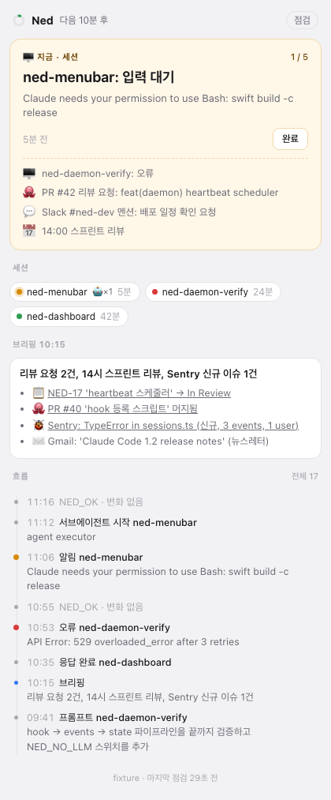 | 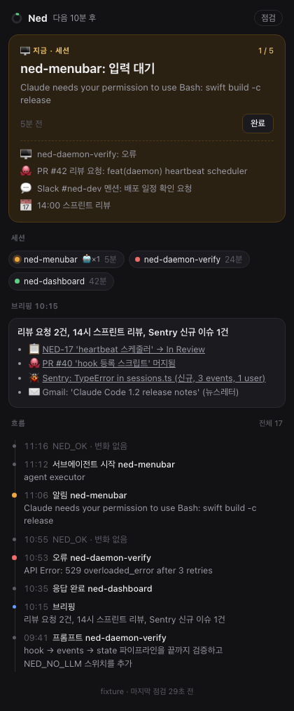 | 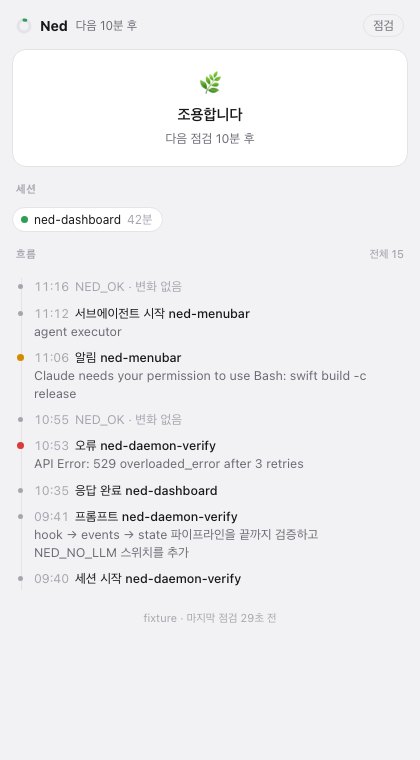 |

## E. 사이드킥 · `sidekick.html`
Ned 는 "의자에 앉은 친구" 다. 헤드셋 끼고 모니터를 지켜보다가 "헤이, 이거 봐" 하고 알려 준다.
브리핑을 Ned 가 말하는 채팅 로그로 보인다. 첫 마디가 요약이고, 세션 → 업무 신호 → 참고 → 로그 → NED_OK 순서로 이어진다.
만화 컷 같은 굵은 테두리와 오프셋 그림자, 살짝 기운 스티커 배지, LED 상태점을 쓴다. 헤더에는 옅은 스캔라인을 깔았다.
**이럴 때:** Ned 를 "도구" 가 아니라 "동료" 로 느끼게 하고 싶을 때. menu bar 의 안경 아이콘과 정체성을 맞추고 싶을 때.
**약점:** 말투와 장식 때문에 항목이 많은 날은 다른 안보다 길어진다. 말투가 취향을 탄다.

| 라이트 | 다크 | 새것 없음 | 스캔 중 헤더 |
|---|---|---|---|
| 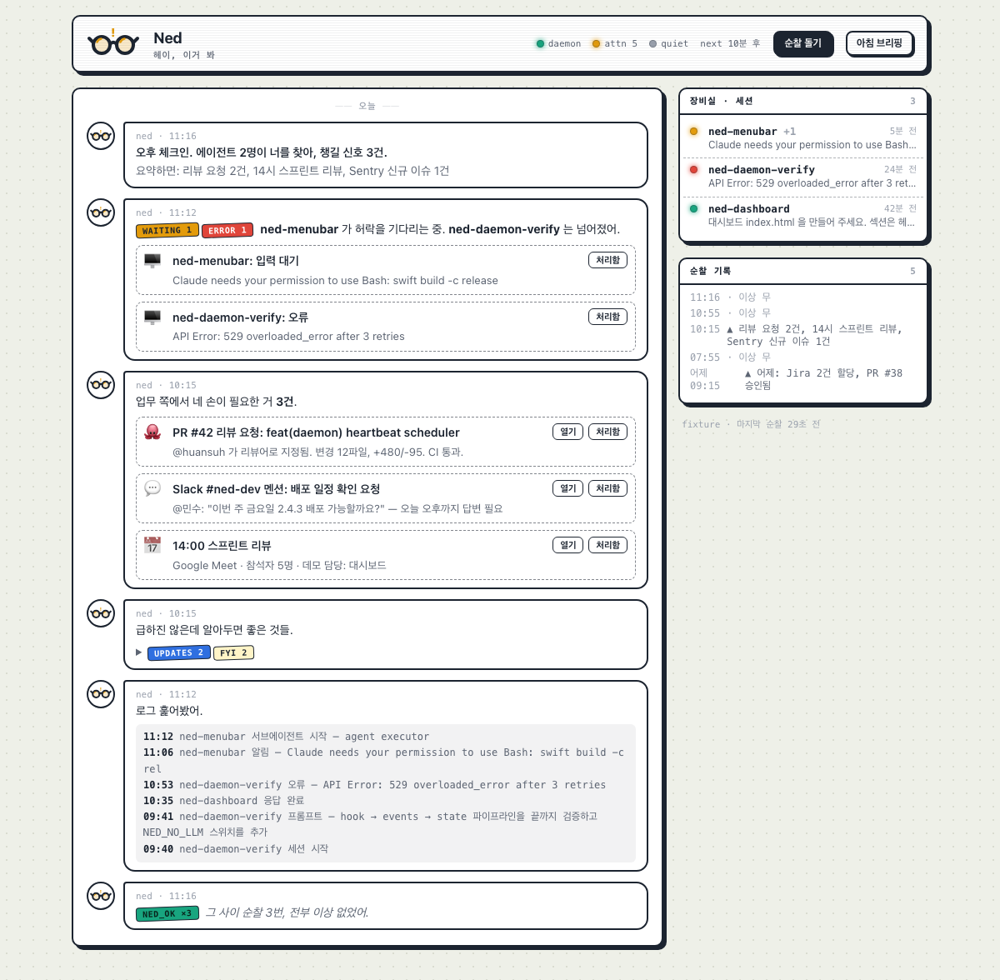 | 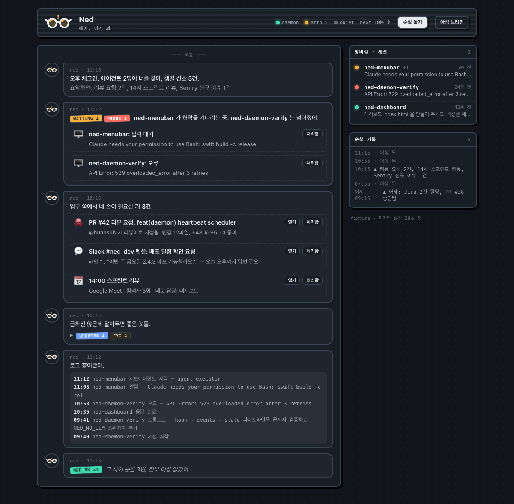 | 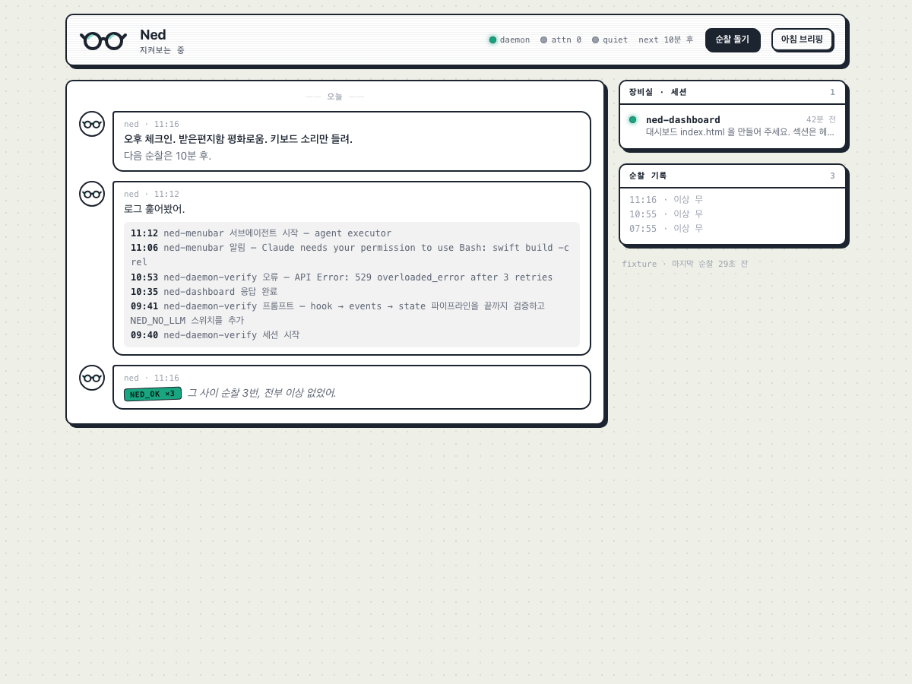 | 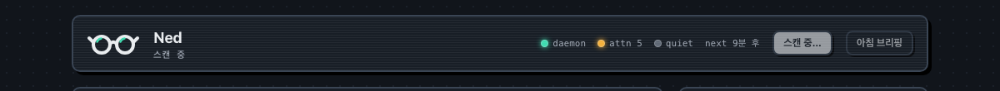 |

### 페르소나: Ned, 의자에 앉은 친구
**말투.** 짧은 반말이고 친한 동료 톤이다. 과장하거나 이모지로 도배하지 않는다. 결정이 필요한 것은 앞에, 농담은 "새것 없음" 일 때만 한다.
쓰기 액션은 절대 하지 않는다. 그래서 말투도 "해 놨어" 가 아니라 "봐 둬", "네 손이 필요해" 쪽이다.

예시 헤드라인:
- `좋은 아침. 리뷰 요청 2건, 14시 스프린트 리뷰 있어. 나머진 내가 보고 있을게.`
- `ned-menubar 가 swift build 허락 기다리는 중. 30초면 끝나.`
- `레이더 깨끗함. 커피 식기 전에 하던 거 마저 해.` (NED_OK)

**안경 상태 ↔ daemon 상태.** 우선순위는 위에서부터다. `sidekick.html` 의 `mood()` 가 이 표 그대로 구현돼 있다.

| 안경 | 조건 | 표시 |
|---|---|---|
| 스캔 중 | heartbeat 실행 중 (`POST /api/heartbeat` 대기) | 렌즈 위로 민트색 빛이 좌우로 훑는다 |
| 자리 비움 | daemon 응답 없음 (`state.updated_at` 이 20분 넘게 지남) | 테가 회색이 되고, 반사광이 꺼지고 `z z` 가 뜬다 |
| 헤이, 이거 봐 | `state.attention.length > 0` (보통 직전 브리핑이 UPDATE) | 렌즈가 호박색으로 물들고 `!` 가 통통 뛴다 |
| 조용한 시간 | `state.quiet` | 반사광이 회색, 렌즈에 옅은 파랑 |
| 지켜보는 중 | 위 조건 모두 아님 (NED_OK) | 민트색 반사광만 있는 기본 상태 |

`prefers-reduced-motion` 이면 애니메이션을 끄고 색만 바꾼다.

**마크.** [`ned-glasses.svg`](ned-glasses.svg) 는 둥근 테 안경을 짙은 남색 둥근 사각 타일 위에 올린 마크다. 앱 아이콘, favicon, menu bar 템플릿 이미지로 같이 쓸 수 있다. 16px 에서도 형태가 남는다. menu bar 에는 SF Symbol `eyeglasses` 를 그대로 두고, 앱 아이콘과 favicon 에 이 마크를 쓰면 두 모양이 자연스럽게 이어진다.

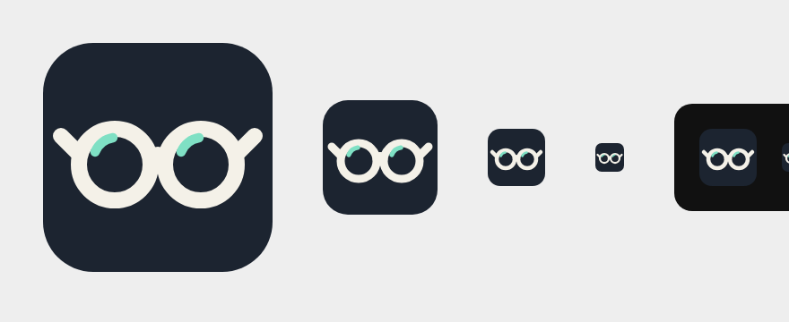

---

## 추천
**C(인박스) 의 구조에 E(사이드킥) 의 정체성을 입혀 `index.html` 로 올리고, D(앰비언트) 는 좁은 창용 보조 화면으로 두는 것을 추천한다.**

- **구조는 C 다.** Ned 가 주는 것은 결국 "결정할 것 몇 건 + 읽을 것 몇 건" 이다. 우선/기타 split 과 `j/k`, `e` 가 이걸 가장 빨리 비운다. 항목이 늘어도 레이아웃이 버틴다.
- **정체성은 E 에서 가져온다.** 안경 마크의 상태 변화, 첫 줄 요약의 말투, NED_OK 한 줄 농담은 화면을 거의 차지하지 않는다. 그런데도 Ned 를 "또 하나의 알림 목록" 이 아니게 만든다. 채팅 로그 전체를 쓰기보다 C 의 상세 패널 머리말과 빈 상태에 Ned 의 말풍선을 넣는 정도가 알맞다.
- **D 는 따로 둔다.** 늘 띄워 둘 창과 몰아서 처리하는 창은 목적이 다르다. D 는 `/ambient` 같은 별도 경로나 menu bar 패널에 맞는다.
- **A 는 화면보다 포맷으로 쓴다.** 아침 브리핑을 메일이나 Slack 으로 보낼 때의 문서 형식으로 쓰기 좋다.
- **B 는 디버그 화면으로 둔다.** 비용, pid, 이벤트 원본을 볼 때 쓰는 숨은 화면으로 충분하다.

## 승격할 때 필요한 것
- daemon 은 지금 `/` 만 서빙한다. 안을 여러 개 두거나 `fixture.js`·`ned-glasses.svg` 를 같이 쓰려면 `public/` 정적 서빙이 필요하다. 아니면 승격할 때 인라인으로 합친다.
- 프로토타입에는 설정 폼이 없다. 기존 `index.html` 의 설정 섹션을 옮겨 붙이거나 별도 화면으로 둔다.
